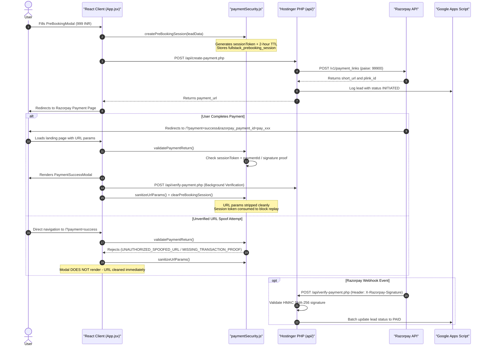

# InstaSkills AI Full-Stack Developer Program — Developer Documentation & Handoff Guide

## 1. Executive Summary & Technology Stack

* **Application Name**: InstaSkills AI Full-Stack Developer Program — High-Conversion Landing Page & Dual-Language Web Platform
* **Primary Objective**: Drive cohort enrollments for the 100-Day AI Full-Stack Developer Program with instant ₹999 seat pre-booking deposit, automated Razorpay payment integration, bilingual support (English/Kannada), and interactive portfolio matrix.
* **Technology Stack**:
  * **Frontend Core**: **React 19 (`^19.2.8`)** + **Vite 8 (`^8.2.1`)** with `@vitejs/plugin-react` (`^6.0.5`)
  * **Styling**: **Tailwind CSS v4** (`@tailwindcss/vite` + `tailwindcss` `^4.3.3`) + Custom Design Tokens ([src/index.css](src/index.css))
  * **Motion & Kinetic Typography**: **GSAP 3.12 (`gsap` `^3.12.5`)** with `ScrollTrigger` & Custom Magnetic Hooks ([src/hooks/useMagnetic.js](src/hooks/useMagnetic.js))
  * **Smooth Scroll**: **Lenis Smooth Scroll (`lenis` `^1.3.26`)** synchronized with GSAP ticker loop
  * **Iconography**: **Lucide React (`lucide-react` `^1.31.0`)**
  * **Localization (i18n)**: React Context API ([src/context/LanguageContext.jsx](src/context/LanguageContext.jsx)) — **English (`en`)** & **Kannada (`kn`)**
  * **Client Security Guard**: Session token guard ([src/utils/paymentSecurity.js](src/utils/paymentSecurity.js)) & custom hook ([src/hooks/usePaymentGuard.js](src/hooks/usePaymentGuard.js))
  * **Backend API**: Production PHP 8 API scripts on Hostinger ([public/api/create-payment.php](public/api/create-payment.php), [public/api/verify-payment.php](public/api/verify-payment.php))
  * **Payment Provider**: **Razorpay Payment Links API** (`/v1/payment_links`) & HMAC SHA-256 Webhook Verification
  * **Lead Storage & Webhook**: **Google Sheets Webhook (Google Apps Script `doPost`)** with high-concurrency batch processing

---

## 2. Complete File Directory Structure

```text
Full-Stack/
├── example_config.php          # Secrets configuration template for /home/uXXXXXXX/config.php
├── hostinger_public_html.zip   # POSIX Linux-compatible deployment package for public_html/
├── index.html                  # HTML entry point with Google Fonts & Meta Pixel tracking
├── package.json                # Dependencies: React 19, Vite 8, GSAP, Lenis, Lucide React, Tailwind v4
├── package-lock.json           # Lockfile for reproducible dependency resolution
├── vite.config.js              # Vite bundler configuration with Tailwind CSS v4 plugin
├── public/                     # Static assets & backend scripts (Auto-copied to dist/ during build)
│   ├── .htaccess               # Hostinger/LiteSpeed HTTPS 307 redirect, MIME types, security headers & SPA fallback
│   ├── favicon.svg             # Application SVG favicon
│   └── api/                    # Production PHP API Endpoints
│       ├── create-payment.php  # Creates Razorpay Payment Link, logs lead to Google Sheet, returns payment URL
│       └── verify-payment.php  # Webhook HMAC SHA-256 handler & client verification with Razorpay API fallback
├── dist/                       # Output of npm run build (Uploaded to Hostinger public_html)
│   ├── .htaccess
│   ├── favicon.svg
│   ├── index.html
│   ├── assets/                 # Minified JS, CSS & image bundles
│   └── api/                    # PHP backend files
└── src/
    ├── main.jsx                # React root entry point
    ├── App.jsx                 # Layout wrapper, modal state coordinator & payment guard subscriber
    ├── index.css               # Global CSS, Tailwind v4 directive (@import "tailwindcss";), color tokens
    ├── assets/
    │   └── images/             # Backgrounds & editorial art (hero-bg, program-art, difference-art, cta-bg)
    ├── context/
    │   └── LanguageContext.jsx # i18n provider for English (en) & Kannada (kn) + ScrollTrigger recalculation
    ├── hooks/
    │   ├── useSmoothScroll.js  # Lenis smooth scroll synchronized with GSAP Ticker
    │   ├── useMagnetic.js      # GSAP magnetic button effect hook
    │   └── usePaymentGuard.js  # Protected route watcher hook (consumes session upon valid return)
    ├── utils/
    │   ├── paymentSecurity.js  # Pre-booking session TTL, URL parameter sanitization & transaction proof guard
    │   └── validation.js       # Strict email/phone input validation & HTML entity sanitization
    └── components/
        ├── LanguageToggle.jsx          # Floating EN / ಕನ್ನಡ language switcher button
        ├── HeroSection.jsx             # Hero section, badges, main heading & CTA buttons
        ├── ProblemOpportunitySection.jsx # Industry problem & developer market opportunity breakdown
        ├── ProgramSection.jsx          # 100-Day Program Pillars (Real Projects, AI Workflows, Career)
        ├── ProjectsSection.jsx         # Real-world AI project showcase (Autonomous Agents, RAG, Web Apps)
        ├── DifferenceSection.jsx       # InstaSkills vs Traditional Coding Bootcamp comparison
        ├── AudienceSection.jsx         # Target audience matrix (College Students, Career Switchers, Freelancers)
        ├── TransformationSection.jsx   # Day 01 vs Day 100 timeline transformation comparison
        ├── FeaturedVideoSection.jsx    # Embedded video masterclass showcase
        ├── FinalCTASection.jsx         # Bottom conversion CTA banner
        ├── Footer.jsx                  # Footer copyright, branding, and legal links
        ├── ContactModal.jsx            # Inquiry & early access form modal
        ├── PreBookingModal.jsx         # ₹999 Cohort seat deposit form (Triggers Razorpay API & session token)
        ├── FreeResourcesModal.jsx      # Free developer roadmap & tools popup modal
        ├── PaymentSuccessModal.jsx     # Post-payment confirmation overlay (Session-guarded)
        ├── PaymentFailedModal.jsx      # Payment failure & retry overlay (Session-guarded)
        ├── Navbar.jsx                  # Top sticky header navigation & CTAs
        ├── GuidedStepNav.jsx           # Floating step navigation guide
        ├── ScrollProgressBar.jsx       # Top viewport scroll progress indicator
        ├── MethodologyComparison.jsx  # Detailed learning methodology comparison matrix
        ├── PortfolioMatrix.jsx         # Interactive filterable full-stack project matrix
        ├── CurriculumSection.jsx       # Modular 14-week curriculum breakdown
        ├── OverviewSection.jsx         # Program high-level executive overview
        ├── ParadigmSection.jsx         # AI Vibe Coding & Agentic Engineering showcase
        ├── TextReveal.jsx              # ScrollTrigger animated heading reveal component
        └── WhatsAppIcon.jsx            # Floating WhatsApp direct connect widget
```

---

## 3. Architecture & Security Subsystems

### 1. Three-Layer Payment Security Architecture



### 2. Strict Domain Origin & Config Policy

Both `create-payment.php` and `verify-payment.php` enforce strict domain validation and resilient config discovery:
* **Allowed Hosts**: Exclusively locked to `fullai.in` and `www.fullai.in`.
* **Zero Foreign Domains**: Localhost and foreign domains are blocked. Any unauthorized cross-origin request receives `HTTP 403 Forbidden` (`{"status": "error", "message": "Origin not allowed"}`).
* **Config Resolution**: Automatically checks `/home/uXXXX/domains/fullai.in/config.php`, `/home/uXXXX/config.php`, and standard Hostinger directory structures outside `public_html`.

---

## 4. API Endpoints Specification

### 1. `POST /api/create-payment.php`
* **Purpose**: Generates a ₹999 Razorpay Payment Link and writes an `INITIATED` record to Google Sheets.
* **Headers**: `Content-Type: application/json`
* **Request Body**:
  ```json
  {
    "name": "Kiran Kumar",
    "email": "kiran.kumar@example.com",
    "phone": "9876543210",
    "page_source": "fullstack-ai-landing",
    "page_url": "https://fullai.in/"
  }
  ```
* **Success Response (HTTP 200)**:
  ```json
  {
    "status": "success",
    "payment_url": "https://rzp.io/i/abc123xyz",
    "link_id": "plink_P123456789"
  }
  ```

### 2. `POST /api/verify-payment.php`
* **Purpose**: Verifies client return parameters or processes Razorpay HMAC SHA-256 webhooks.
* **Webhook Mode**: Validates `X-Razorpay-Signature` against `RAZORPAY_WEBHOOK_SECRET`.
* **Client Mode**: Validates signature or queries Razorpay `/v1/payments/{payment_id}` via server-side cURL fallback.

---

## 5. Developer Commands

```bash
# 1. Install dependencies
npm install

# 2. Local development server
npm run dev

# 3. Type check & build production bundle
npm run build

# 4. Generate Linux/POSIX-compatible deployment archive
npm run zip
```

---

## 6. Senior Engineering Quality Checklist

* [ ] `npm run build` passes with 0 bundling errors.
* [ ] English & Kannada translations sync cleanly in `LanguageContext.jsx`.
* [ ] `.htaccess` contains 307 HTTPS redirect, SPA rewrite rules, and GZIP compression.
* [ ] `/home/uXXXXXXX/config.php` configured outside `public_html/`.
* [ ] Direct navigation to `/?payment=success` is rejected by `validatePaymentReturn()`.
